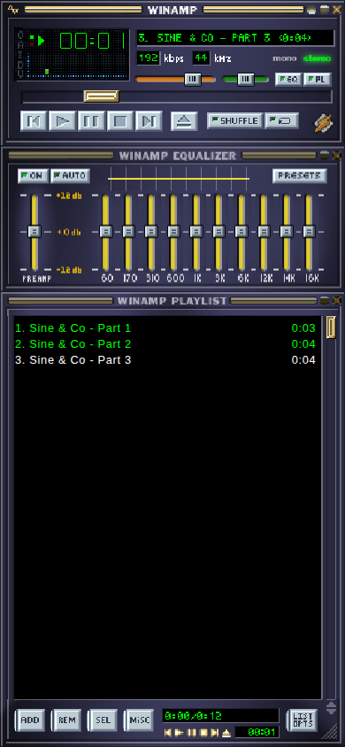

# Gapless Amp

Winamp, on an iPhone home screen, for the albums that never made it to
streaming. It plays MP3s stored on the device, looks like Winamp 2.91 (or any
classic skin you load), and does not put a gap between tracks.



It is a web app with no build step and no backend: static files, installed with
Safari's *Add to Home Screen*. Nothing is uploaded anywhere.

## Using it

**Getting music in.** There is no library. As in the original, the playlist is
the only thing you manage, and the Files app is where you browse. `ADD`, the
eject button, and Play on an empty playlist all open the Files picker. Select an
album's files (Select All works inside a folder) and they are queued in the
right order, whatever order the picker returned them in and whatever the files
are called: album, disc and track number come from the ID3 tags.

**What stays on the phone.** iOS will not let a web app reopen a file it was
shown earlier, so picked files are copied into the app's own storage. A copy is
kept for exactly as long as something refers to it:

- it is in the playlist, or
- it is in a saved list (`LIST OPTS` → `SAVE LIST`).

Remove it from both and it is deleted from the device. So `REM ALL` or
`NEW LIST` on an unsaved album really does free its space, and saving a list is
how you keep an album around to reload with one tap from `LOAD LIST`. Deleting a
saved list (the button beside it in `LOAD LIST`) is what finally frees its
files. The originals in Files are never touched.

The playlist, and the track you were on, come back when the app is reopened.

**The playlist editor's buttons**

| | |
|---|---|
| `ADD` → URL | Queue an MP3 by web address. Streamed, not stored; the server must allow cross-origin requests. |
| `ADD` → DIR / FILE | Open the Files picker. (iOS has no folder picker, so both do the same.) |
| `REM` → MISC | Remove dead entries and duplicates. |
| `REM` → ALL / CROP / SEL | Clear the list, keep only the selection, remove the selection. |
| `SEL` | Invert, select none, select all. |
| `MISC` → SORT | Sort by title, reverse, randomize. |
| `MISC` → INFO | Tags, length, bitrate and file details of the selected track, including whether it carries gapless information. |
| `MISC` → OPTS | Storage used, **Load skin**, **Default skin**, and the audio output mode (below). |
| `LIST OPTS` | New list, save list, load list. |

**Skins.** `MISC` → `OPTS` → *Load skin* takes any classic `.wsz`. The choice is
remembered; *Default skin* returns to the Winamp 2.91 base skin. Dialogs are
drawn from the loaded skin too.

**Gapless.** Works for MP3s that carry a LAME/Xing header, which is nearly all
of them; `MISC` → `INFO` says whether a given file does. Shuffle is not gapless,
since the next track is not known in advance.

## Installing

Serve the directory over **HTTPS** (a service worker needs a secure context;
`localhost` also counts), open it in Safari on the phone, then *Share → Add to
Home Screen*. After the first launch it works with no network.

```sh
python3 serve.py 8080        # http://localhost:8080
./deploy.sh                  # the author's setup: a container on a home server, reached over Tailscale
```

The service worker answers from its cache and refreshes in the background, so a
new build appears on the second launch after it is deployed.

## How it works

```
Files picker ─► tags.js ─► OPFS (audio) + IndexedDB (records, covers, lists)
                                │
        Webamp UI ◄── app.js ───┤
            │                   ▼
            └─► media.js ─► decode-worker.js ─► player-worklet.js ─► speaker
               (IMedia)      mpg123 (WASM)        AudioWorklet
```

**The skin** is [Webamp](https://github.com/captbaritone/webamp), a
reimplementation of Winamp 2 in the browser. Its three windows are stacked in a
275px column and zoomed to the width of the screen; the playlist is pinned to
whatever height is left.

**Gapless playback** is the part Webamp does not do. Its own audio plays each
file through an `<audio>` element and loads the next when one ends, and MP3
files carry encoder padding at both ends, so there is always a gap. Here
Webamp's audio backend is swapped out (`media.js`, via its `__customMediaClass`
hook) for a single continuous PCM stream:

- `decode-worker.js` decodes with mpg123 compiled to WebAssembly, which reads
  each file's LAME header and trims the encoder delay and padding. It runs about
  30 seconds ahead of playback and rolls straight from one file into the next.
- `player-worklet.js` plays that stream from an AudioWorklet and reports which
  track, and which sample of it, is sounding.
- Webamp still believes it changes tracks itself. When playback crosses into the
  next track, `media.js` reports the old one as ended; Webamp asks for the next
  track, which is the one already playing, and the request is simply accepted.

Because the worker walks its own queue, a track change needs nothing from the
main thread, which iOS may throttle once the phone is locked.

**Background audio on iOS.** Plain Web Audio tends to be suspended on lock and
obeys the mute switch. So the graph's output is routed through an `<audio>`
element, which iOS treats as media playback and gives lock-screen controls.
`MISC` → `OPTS` → *Audio* switches between that route (*background*) and plain
Web Audio (*direct*), to compare on a real device.

**Storage.** Audio lives in OPFS, which hands back a disk-backed `File` that is
read in slices rather than loaded into memory. Track records, cover art, saved
lists, the current playlist and the chosen skin are in IndexedDB. Unreferenced
files are collected a few seconds after the playlist changes (`collect()` in
`app.js`).

| File | |
|---|---|
| `app.js` | Layout, the file cache, playlist persistence, the playlist buttons and dialogs |
| `media.js` | Webamp's audio backend, replaced |
| `decode-worker.js` | MP3 → PCM, gapless, ahead of playback |
| `player-worklet.js` | Plays the PCM stream |
| `tags.js` | ID3v1/v2.2/v2.3/v2.4 parsing (including mislabelled Shift-JIS), length from the Xing header, album grouping |
| `store.js`, `store-worker.js` | IndexedDB and OPFS |
| `sw.js` | Offline cache |
| `vendor/` | Browser builds of Webamp and mpg123-decoder, copied from `node_modules` |

## Tests

```sh
npm install
test/make-fixtures.sh        # needs ffmpeg and ImageMagick
npm test
```

The fixtures are one continuous sine wave cut into three MP3s at points that
are deliberately not on frame boundaries. `npm test` checks that decoding them
back to back reproduces the original sample for sample (and that it fails by
about 2,000 samples per join with gapless trimming off), plus tag parsing and
album ordering.

`test/e2e.playwright.js` is the same check through the whole app in a real
browser: add the files, press Play, record what reaches the audio graph, and
compare it with the source. It is written to be run through a Playwright
session against `serve.py`.

## Known limits

- MP3 only.
- The automated tests run in desktop Chromium at phone size. Lock-screen and
  background playback on iOS are the part most likely to need attention on a
  real device.
- Webamp is a mouse-first UI: its submenus and window dragging are fiddly under
  a thumb.
- Winamp's `REM MISC` also offered to delete the selected file from disk; here
  deleting follows from removing a track from the playlist and saved lists.

## Credits

[Webamp](https://github.com/captbaritone/webamp) by Jordan Eldredge and
[mpg123-decoder](https://github.com/eshaz/wasm-audio-decoders) by Ethan Halsall,
both MIT-licensed. The decoder is a WebAssembly build of
[mpg123](https://www.mpg123.de/), which is LGPL 2.1. Winamp and its skins belong
to their respective owners.
